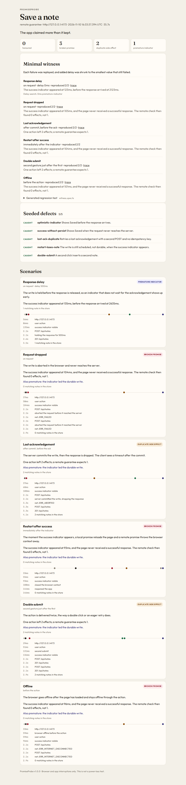
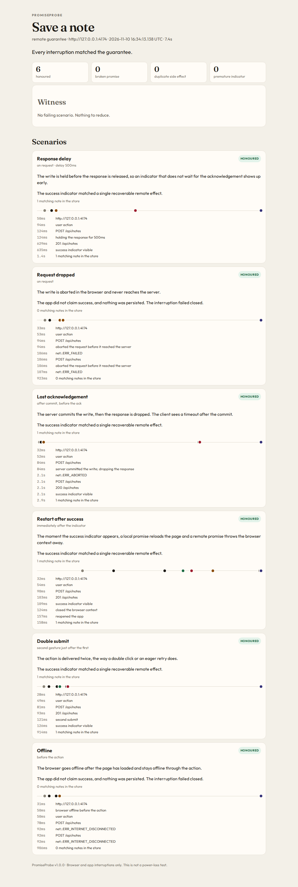

# PromiseProbe

PromiseProbe is a test harness for a specific kind of lie: the app says the work is saved, and it is not.

A note form paints **Saved ✓** while the POST is still queued. A checkout button says **Submitted** and then loses the response. A registration screen says **Registered** and a second click creates a second account. The UI has made a promise. PromiseProbe checks whether that promise was one the app could keep.

You describe the promise. The harness interrupts the app around the action, then asks an independent question: is the work actually recoverable?

## Quick start

```bash
npm install
npm test
npm run demo
```

`npm test` downloads Chromium if it is not installed yet. On a fresh Linux image, system libraries may also be missing. Install them once:

```bash
npx playwright install --with-deps chromium
```

The demo runs the same promise against two notes apps and writes a report for each:

```text
Broken notes  0 honoured, 3 broken, 2 duplicate, 1 premature · seeded 5/5 · 35.7s
Fixed notes   6 honoured, 0 broken, 0 duplicate, 0 premature · 7.4s
```

Open `reports/broken/report.html` and `reports/fixed/report.html`. Those files are generated by the demo.

Run one probe yourself:

```bash
npx promiseprobe run examples/broken-notes/probe.ts --out reports/broken
npx promiseprobe run examples/fixed-notes/probe.ts --out reports/fixed --strict
```

`--strict` exits 1 when any scenario is not honoured. The default demo does not need a cloud account. The optional AWS backend is below, and it is the only cloud backend in this repo.

## The contract

A promise is a user action, the success indicator the user can see, and a persistence check that does not trust that indicator.

```ts
import path from 'node:path';
import { fileURLToPath } from 'node:url';
import { definePromise } from 'promiseprobe';

const dir = path.dirname(fileURLToPath(import.meta.url));

export default definePromise({
  name: 'Save a note',
  guarantee: 'remote', // 'local' for a draft that lives in browser storage
  app: {
    url: 'http://127.0.0.1:4174',
    start: {
      file: path.join(dir, 'server.ts'),
      env: { PORT: '4174' },
    },
  },
  prepare: async ({ page, bag }) => {
    await page.getByLabel('Note').fill(bag.text ?? '');
  },
  action: async ({ page }) => {
    await page.getByRole('button', { name: 'Save' }).click();
  },
  successIndicator: async ({ page }) => {
    const text = await page.getByTestId('status').textContent();
    return (text ?? '').trim() === 'Saved ✓';
  },
  persistenceCheck: async ({ request, appUrl, bag }) => {
    const url = new URL('/api/notes', appUrl);
    url.searchParams.set('text', bag.text ?? '');
    const res = await request.get(url.toString());
    const body = await res.json();
    return { count: body.notes.length };
  },
});
```

`bag.text` is a fresh value for every scenario, so checks do not collide. The persistence check runs through Playwright's API request context, outside the page, so a fault injected into the page does not hide the truth from the check.

`guarantee` changes what "recoverable" means:

- **remote** — the effect has to be on the server. The success indicator is premature if it appears before the page receives a successful response. Restarting throws the browser context away and asks the server again.
- **local** — the effect has to be in durable browser storage. Provide `durabilitySignal` so PromiseProbe can see when that write lands. Restart reloads the page in the same profile. A dropped request is fine when the local write is really there.

For a local draft, the check reads `localStorage` after the reload. See `examples/local-draft`.

Put `data-promiseprobe-action` on the button the user activates. The double-submit scenario delivers a second click to that control.

## Scenarios

Every probe is swept through these interruptions. Timing is part of the scenario: faults land on the write, before the action, or the instant the indicator appears.

| Scenario | What it does |
| --- | --- |
| Response delay | Holds the write response (500ms by default) so an indicator that does not wait for the acknowledgement shows up early. |
| Request dropped | Aborts the POST in the browser. The server never sees it. |
| Lost acknowledgement | Lets the server commit, then drops the response. The client observes a timeout after the commit. |
| Restart after success | Reloads the page for a local guarantee, or discards the browser context for a remote one, as soon as the indicator is visible. |
| Double submit | Delivers the action twice. |
| Offline | Loads the app, then takes the browser offline before the action. |

The run ends when write attempts have gone quiet (`quietMs`, default 800) or when `settleMs` (default 8000) elapses, whichever comes first. A write that is still in flight keeps the run open, so a deferred POST is not checked too early.

## Verdicts

Each scenario gets one verdict.

| Verdict | Meaning |
| --- | --- |
| Honoured | The indicator and the recoverable effect agree. Saying nothing, and persisting nothing, is honoured: the interruption failed closed. Saying nothing while a single effect is recoverable is also honoured: a reload can finish the job without a second write. |
| Broken promise | The indicator said success, and the check could not find the effect. |
| Duplicate side effect | One action left more persisted effects than the promise allows (default 1). |
| Premature indicator | The indicator appeared before the guarantee's durable point, and the effect did land exactly once. For a remote promise that point is the response. For a local promise it is `durabilitySignal`. |

A duplicate wins over the other verdicts. A success claim with nothing saved is a broken promise, and the report still notes when that claim was also early. Restart asks whether the effect survived the cut. An early indicator on a write that then survives is scored by the delay scenario.

PromiseProbe scores false claims and duplicated effects. A button that quietly does nothing, with no success indicator, is not called a broken promise.

## Report

The run writes `report.html`, `report.json`, and, when something fails, `witness.spec.ts` plus a Playwright trace for each reduced failure.





The HTML report is one file. Open it from disk. Each scenario has a timeline, the verdict, and a link to its trace (`npx playwright show-trace <file.zip>`).

## Reduction

A failing scenario is shrunk to the smallest added delay that still produces the same verdict, then run once more to confirm. Response delay on the broken app collapses to **0ms**: the indicator is early even when the harness adds no latency, because the app paints Saved before it sends the POST.

The witness is a standalone Playwright script:

```bash
npx tsx reports/broken/witness.spec.ts
```

It boots the app, replays each minimal failure, and asserts the verdict. It keeps failing while the bug remains. When you fix the app, the witness fails, and that is the point: the pinned behaviour changed.

## Reference apps

Both notes apps are local Node servers. `npm run demo` starts them and stops them.

**Broken** (`examples/broken-notes`) plants five defects:

1. **optimistic-indicator** — paints Saved before the response.
2. **success-without-persist** — paints Saved when the request never arrives.
3. **lost-ack-duplicate** — retries a lost acknowledgement with a new POST and no idempotency key.
4. **restart-loses-note** — the POST is scheduled two seconds after the indicator, so a restart in that window loses the note.
5. **double-submit** — a second click inserts a second note.

The offline scenario fails too, as a broken promise. It is the same false claim as the dropped request, so the seeded count stays at five.

**Fixed** (`examples/fixed-notes`) waits for a response before it says Saved, reuses one idempotency key for the retry, and ignores a second click while a save is in flight. The server stores one note per key. The same key and the same text replay the original write. The same key and a different text is a conflict.

**Local draft** (`examples/local-draft`) is the local-guarantee fixture. `?mode=good` writes `localStorage` and then shows Saved. `?mode=early` shows Saved and writes 400ms later. `?mode=lie` shows Saved and never writes. The end-to-end tests cover all three.

### Optional AWS backend

`examples/aws-backend` is a SAM app: HTTP API, Lambda, and a DynamoDB table. The write is a conditional `PutItem` (`attribute_not_exists`) keyed by the idempotency key. A repeated key with the same text returns the original note. You do not need it for the demo.

```bash
cd examples/aws-backend
npm install
sam build
sam deploy --guided
```

## Measured on this repo

`npm run metrics` sweeps both notes apps five times with reduction turned off, so the number is the sweep itself. These figures are from that run:

| | Broken app | Fixed app |
| --- | --- | --- |
| Seeded defects detected | 5 / 5 | — |
| Reproduction across 5 runs | 25 / 25 (100%) | 5 / 5 runs, 6 / 6 scenarios honoured |
| Mean sweep time | 16.6s | 7.4s |

Every broken run produced the same verdicts: premature indicator on response delay, broken promise on the dropped request, the restart, and offline, and a duplicate side effect on the lost acknowledgement and the double submit. Zero harness errors.

A single demo run that also reduces failures and writes the witness took 35.7s on the broken app and 7.4s on the fixed app. Added delay on the premature indicator reduced from 500ms to 0ms, and every witness reproduced on the confirmation run (2/2).

## Limitations

PromiseProbe interrupts the browser and the app: routing, dropped responses, offline mode, reload, and a new browser context. It does not simulate physical power loss, an operating system kill during a disk flush, or a database host dying under a commit that the client already observed.

A few more bounds for v1:

- The success indicator is sampled from the page. A gap under 50ms is inside that slack and is not called premature.
- You supply the persistence check. The harness does not infer your schema.
- One promise is one action and one expected effect.
- Reduction assumes a single delay threshold: once a delay fails, every longer delay fails the same way.
- A retry that starts later than `quietMs` can be missed. The examples retry immediately. Raise `quietMs` if yours waits.

## Roadmap

- Promises that span several requests, such as a wizard.
- Background sync and service-worker durability, still as a local or remote guarantee.
- Richer network faults: loss and constrained bandwidth, alongside the offline switch.
- A second build compared against a saved report.
- Keeping witness history as the app changes.

## Development

Node 20 or newer.

```bash
npm test          # typecheck, unit tests, and the end-to-end sweep
npm run demo      # broken vs fixed, and refreshes docs/report-*.png
npm run metrics   # five repeats, writes reports/metrics.json
npx promiseprobe run examples/local-draft/probe.ts --out reports/local
```

The end-to-end test asserts that the broken app trips every seeded defect, the fixed app honours all six scenarios, and the local draft distinguishes a real save, an early indicator, and a save that never writes.

GitHub Actions runs the same `npm test` after installing Chromium and its system libraries.

## License

[MIT](LICENSE)
